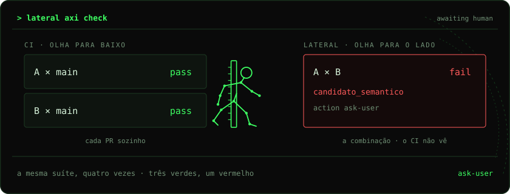

<p align="center">
  
</p>

<p align="center">
  <strong>LATERAL</strong><br>
  <sub>o CI olha para a <code>main</code>. isto olha para o lado.</sub>
</p>

<p align="center">
  <code>python -m lateral</code>
  ·
  <a href="docs/produto.html">deck</a>
</p>

---

Cruza feature branches ativas **antes** do merge. Não mescla. Não apaga teste vermelho. A pessoa decide.

<p align="center">
  
</p>

Cada branch passa sozinha contra a `main`. As duas juntas quebram. O CI de um PR não testa isso.

## install

```bash
python3 -m pip install -e /caminho/para/lateral
cd o-seu-repo
python -m lateral init --harness cursor    # claude, kiro, codex, agy, all
```

Grava `.lateral/config.toml`, um bloco em `AGENTS.md` e os commands do harness.

## loop

```bash
python -m lateral axi intent --text "cobrar em centavos"
python -m lateral axi check
```

```json
{
  "schema": "lateral.axi/v1",
  "command": "check",
  "awaiting": "human",
  "pares": [
    {
      "id": "feat/centavos|feat/frete",
      "status": "candidato_semantico",
      "action": "ask-user"
    }
  ]
}
```

`awaiting: human` → o harness resume e **para**.

```
/lateral-intent    a tarefa, em português — não o resumo do diff
/lateral           axi check · JSON no stdout, markdown em .lateral/last/
/lateral-status    o último envelope
/lateral-scan      um par
```

Humano: `python -m lateral check`. Harness: `python -m lateral axi check`.

## o motor

```
tarefa → cruzamento → juntar → build → testes → intenção → teste extra
```

Junta as duas sem mexer no working tree. A mesma suíte, quatro vezes. Haiku lê as duas tarefas e, se a suíte passou, propõe um teste; a suíte aceita ou descarta. No máximo duas chamadas curtas. Sem chave, a camada é `skipped`.

```
conflito_textual        as duas já não se encaixam
conflito_build          juntas não compilam
candidato_semantico     teste que só quebra juntas
risco_intencao          as tarefas se contradizem
limpo                   segue
```

## não faz

```
×  merge
×  auto-fix
×  apagar teste vermelho
×  tratar arquivo em comum como prova
```

Duas branches podem brigar sem tocar o mesmo path. O motor junta e testa, não só lista arquivo.

## lab

Gitea local. Dois lados, um `main`. O detector, não a frequência em campo.

```bash
cp .env.exemplo .env                   # ANTHROPIC_API_KEY
python3 -m pip install -e '.[dev]'
python3 -m pytest -q
cd lab && ./lab.sh subir && ./lab.sh demo c01-centavos-frete
# http://localhost:3310   lab / lab-local-123
```

```bash
./lab.sh rodar c01-centavos-frete      # Haiku, gasta token
./lab.sh descer
```

<p align="center">
  <sub>
    <a href="docs/produto.html">produto</a>
    ·
    <a href="AGENTS.md">AGENTS.md</a>
  </sub>
</p>
